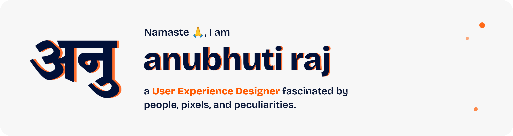

### hi, I'm Anu 👋

I grew up on the southern banks of the Ganga in Patna, where stories live in street markets, monsoon worn posters and hand painted shop signs. Those were my first lessons in design, long before I had a word for it.

Now I'm a final year **UX design** student at **MIT Institute of Design, Pune**. I start with research and end with a story, so the solution stays with people. Most of my favourite work sits somewhere between people, screens and cars 🚗

- 🎓 B.Des in UX Design, MIT ID Pune (2023 to 2027)
- 🇫🇷 Spent a semester in France at ESAD Orléans: net art, Blender, gamified websites, and training my own AI models
- 🛠️ Most recently a UX design intern at **Tata Motors**, on the DPDS team
- 🚘 Researched how a self driving car should hand control back to its driver, mentored by engineers at **Valeo** and **Renault**

 

### 📂 things I've made

| project | what it is |
|---|---|
| 🌐 **[My portfolio](https://rajanubhuti.github.io/portfolio/)** | My little corner of the internet, built by hand in plain HTML, CSS and JS. [Code here](https://github.com/rajanubhuti/portfolio) |
| 🚗 **[Designing the Return](https://rajanubhuti.github.io/portfolio/my-work/project-1/)** | An in car display for the sixty seconds before a Level 3 car hands control back to its driver |
| 🎫 **[Tata Motors Ticketing Assistant](https://rajanubhuti.github.io/portfolio/my-work/project-2/)** | Turning an internal ticketing form into an assistant that helps people find answers first |
| 📚 **[LumiTrack](https://rajanubhuti.github.io/portfolio/my-work/project-3/)** | A teaching dashboard that gives design faculty their time back |
| 🎨 **[LoRA workshop notes](https://github.com/rajanubhuti/ai-workshop-documentation)** | Teaching image models my hair clip, Madhubani art, and the world of *Tumbbad* |

 

### 🔍 how I work

**1. Listen** · start with people, not screens 
**2. Make sense** · find the one problem worth solving 
**3. Make** · sketch, then flows, then screens 
**4. Test and tell** · check it with people, then tell its story

 

### 🧰 on my desk

`Figma` `Framer` `Photoshop` `Illustrator` `After Effects` `Blender` `Notion` `Jira` `HTML` `CSS` `JavaScript` `Python (basic)` `VS Code` `Claude Code`

 

### 📸 when I'm not designing

I'm out with a camera, trying a new art technique (cyanotype was a fun one), or planning the next trip. Here's [Patna to Paris](https://rajanubhuti.github.io/portfolio/play/), a little gallery from my first time abroad by myself.

And I can say hello in **नमस्ते** · **Hello** · **Bonjour** · **Hallo**

 

### 💌 let's tinker together

[Portfolio](https://rajanubhuti.github.io/portfolio/) · [LinkedIn](https://www.linkedin.com/in/anubhutiraj-ux) · [Behance](https://www.behance.net/anubhutiraj) · [anubhutiraj.ux@gmail.com](mailto:anubhutiraj.ux@gmail.com)
